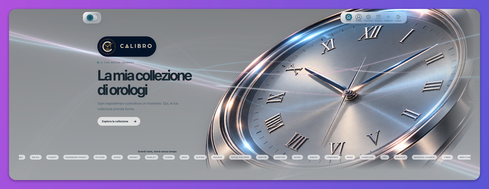
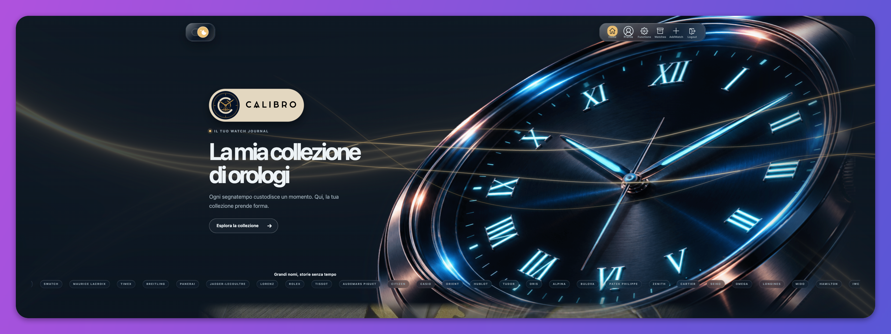
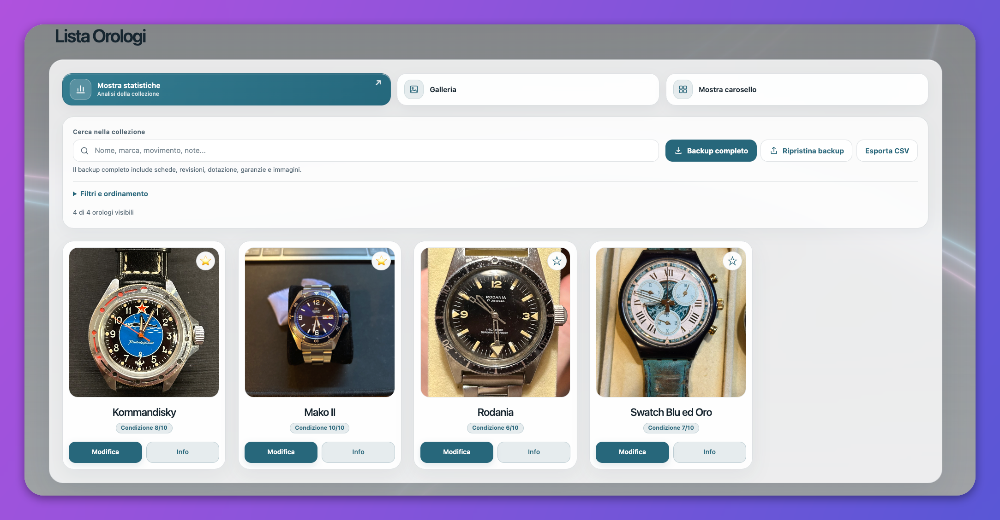
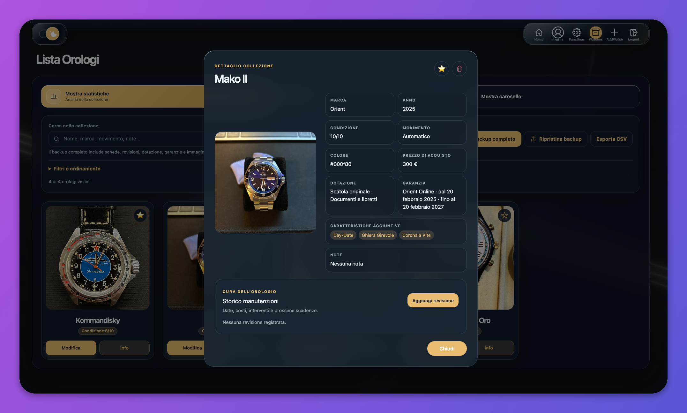
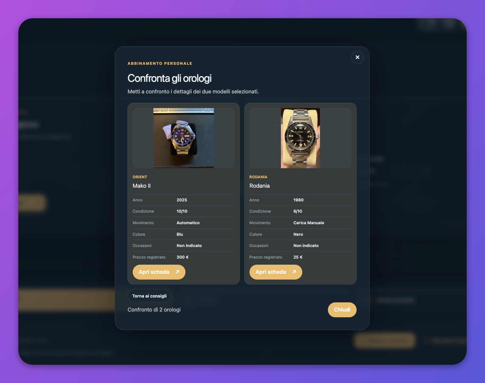

# ⌚ Calibro - La tua collezione di orologi digitale

Calibro è un'applicazione web moderna e responsiva progettata per gli appassionati di orologi che desiderano catalogare, gestire e interagire con la propria collezione personale in modo intuitivo e veloce.

---

## Indice
- [🚀 Funzionalità Principali](#-funzionalità-principali)
- [🧠 Funzioni Intelligenti e Interattive](#funzioni-intelligenti-e-interattive)
- [🎧 Interfaccia Utente e Performance](#interfaccia-utente-e-performance)
- [🛠️ Stack Tecnologico](#️-stack-tecnologico)
- [📷 Screenshots](#-screenshots)
- [📈 Contributing](#-contributing)
- [👤 Contributors](#-contributors)
- [📍 Roadmap](#-roadmap)
- [📧 Contatti](#-contatti)
- [🫶 Ringraziamenti](#-ringraziamenti)

---

## 🚀 Funzionalità Principali
- Gestione e Visualizzazione della Collezione
- Registrazione e Accesso Utente: Autenticazione sicura tramite Supabase.
- Gestione Orologi: Inserimento, modifica ed eliminazione degli orologi dalla collezione.
- Vista Dinamica: Alternanza tra la visualizzazione a Griglia, con la possibilità di selezionare gli orologi preferiti, e la visualizzazione a Carosello.
- Organizzazione Avanzata: Ricerca testuale, filtri per marca, preferiti, anno e prezzo, ordinamento e esportazione CSV dei risultati.
- Scheda completa: Condizione da 1 a 10, dotazione, garanzia e informazioni del centro assistenza per ogni orologio.
- Registro revisioni: Storico degli interventi con date, costi, fornitori e prossima scadenza.
- Promemoria revisioni: Avvisi per gli orologi prossimi alla revisione, eliminabili dalla schermata.
- Backup completo: Esportazione e ripristino incrementale di orologi, revisioni, immagini e preferenze outfit.

Il backup completo è un file JSON autonomo con le immagini incluse. Il ripristino unisce i dati: aggiorna i record con lo stesso identificativo di backup e lascia inalterati gli altri. Per usare dotazione, garanzia, revisioni e backup, applica la migrazione `supabase/migrations/20261022_watch_collection_extensions.sql`; per condizione, occasioni d’uso e preferenze outfit applica anche le migrazioni `supabase/migrations/20261023_watch_condition_rating.sql` e `supabase/migrations/20261023_watch_outfit_preferences.sql`.

## 🧠 Funzioni Intelligenti e Interattive
- Valore Totale: Calcolo in tempo reale del valore complessivo della collezione.
- Orologio del Giorno: Selezione casuale di un orologio dalla collezione per suggerire cosa indossare.
- Completa l'Outfit: Analisi visiva dell’immagine, filtri per occasione e colore, preferenze 👍/👎, confronto tra due orologi e preparazione guidata dei modelli senza analisi AI.
- Statistiche collezione: Valore registrato, condizione media, dotazione, garanzia, distribuzione per marca e movimento, valutazioni e decenni di produzione.

## 🎧 Interfaccia Utente e Performance
- Modalità Scuro/Chiaro: Toggle dinamico della Dark Mode.
- Effetti Visivi: Effetto "frosted glass" sulla barra di navigazione.
- Orologio Analogico Funzionante: Un orologio analogico in CSS e JavaScript puro che mostra l'ora attuale.
- Brand Scroller: Liste di marchi in scorrimento continuo per un tocco estetico.

## 🛠️ Stack Tecnologico

| Categoria | Tecnologia | Note |
| :--- | :--- | :--- |
| **Frontend** | **React** (Hooks, `useMemo`, `useTransition`) | Sviluppo dell'interfaccia utente. |
| **Styling/Animazioni** | **Framer Motion** | Per animazioni fluide del layout (effetto FLIP nel cambio di ordine dei preferiti). |
| **Carosello** | **Swiper.js (via React)** | Componente leader per caroselli e slider. |
| **Backend/DB** | **Supabase** | Backend-as-a-Service (Auth, Database PostgreSQL, Storage). |
| **Storage** | **Supabase Storage** | Gestione dello storage delle immagini. |

## 📷 Screenshots

Screenshot della versione aggiornata dell’applicazione:

## 📈 Contributing

Grazie per voler contribuire! Puoi contribuire tramite:
- Segnalazioni di bug (issue)
- Proposte di funzionalità (issue)
- Pull request con fix o miglioramenti

Linee guida rapide:
1. Fork del repository.
2. Crea un branch feature/bugfix: git checkout -b feature/nome-feature
3. Fai i tuoi cambiamenti e committa: git commit -m "Descrizione"
4. Apri una pull request verso il branch principale del repo originale.

## 📍 Roadmap

### Completato

- [x] Selettore delle varie complicazioni
- [x] Note aggiuntive per ogni orologio
- [x] Condizione dell'orologio (scala 1-10)
- [x] Dotazione: Scatola, documenti e accessori.
- [x] Garanzia: Periodo e rivenditore o centro assistenza.
- [x] Registro revisioni: Date, interventi, costi e prossima scadenza.
- [x] Promemoria per le revisioni imminenti con possibilità di eliminare l’avviso.
- [x] Backup e ripristino completo con immagini e unione dei dati.
- [x] Filtri di ricerca avanzati per marca, prezzo, anno
- [x] Suggerimenti outfit con filtri, feedback, confronto e gestione dei modelli non ancora analizzati.
- [x] Schermata statistiche ampliata e responsive.

### Prossimi sviluppi

- [ ] Importazione CSV con anteprima, verifica dei campi e rilevamento dei duplicati.
- [ ] Prezzo e data di acquisto per seguire nel tempo la spesa e il valore dichiarato della collezione.
- [ ] Analisi dei costi di manutenzione per anno e per orologio.
- [ ] Notifiche configurabili per scadenze di garanzia e prossime revisioni.
- [ ] Archiviazione degli orologi venduti mantenendo consultabili scheda e manutenzioni.

## 👤 Contributors

<!-- ALL-CONTRIBUTORS-LIST:START - Do not remove or modify this section --> 
<!-- prettier-ignore-start -->
<!-- markdownlint-disable -->
| Name | Role |
| --- | --- |
| [effe1209](https://github.com/effe1209) | 👨‍💻 Mantainer, Code |
| [altroUtente](https://github.com/altroUtente) | 📝 Documentazione |
<!-- markdownlint-enable -->
<!-- prettier-ignore-end -->
<!-- ALL-CONTRIBUTORS-LIST:END -->

## 📧 Contatti

- Maintainer: effe1209 — https://github.com/effe1209

## 🫶 Ringraziamenti

- Supabase — per backend e storage
- Framer Motion — per le animazioni
- Swiper.js — per il carosello
